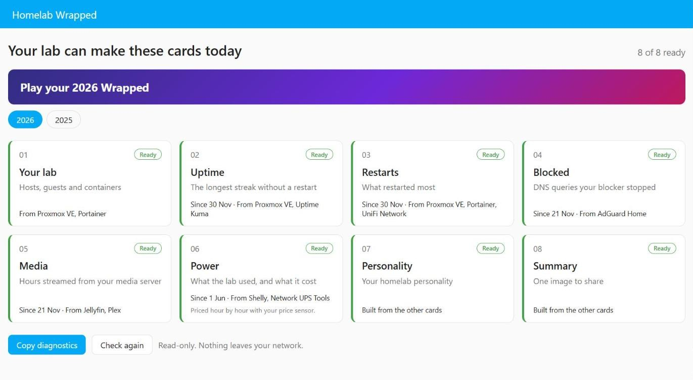
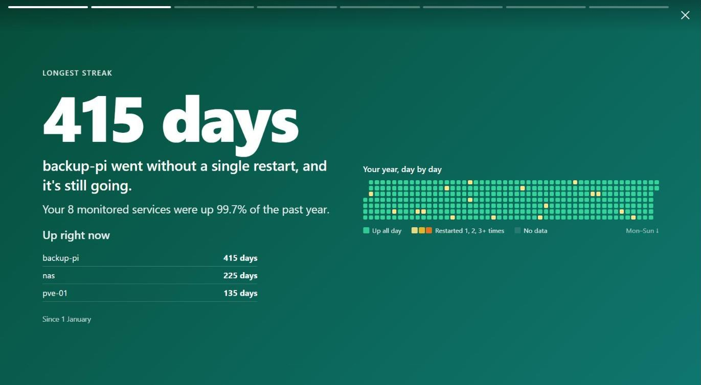
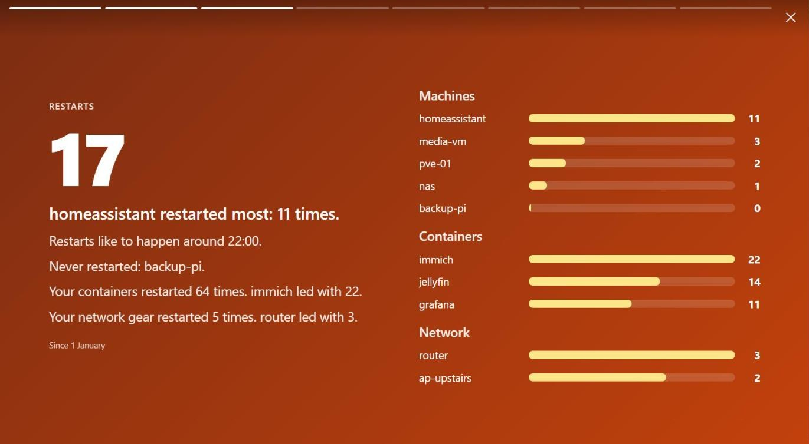
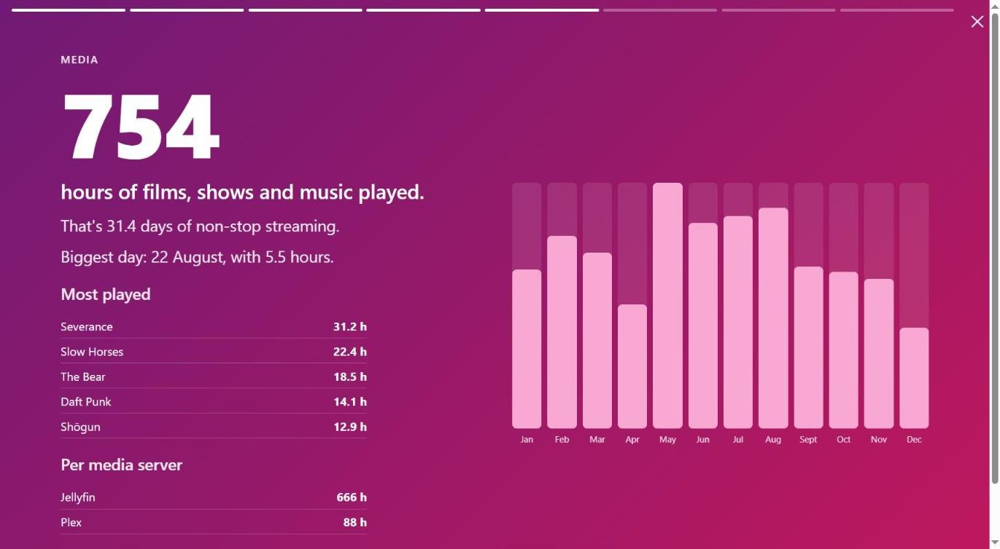
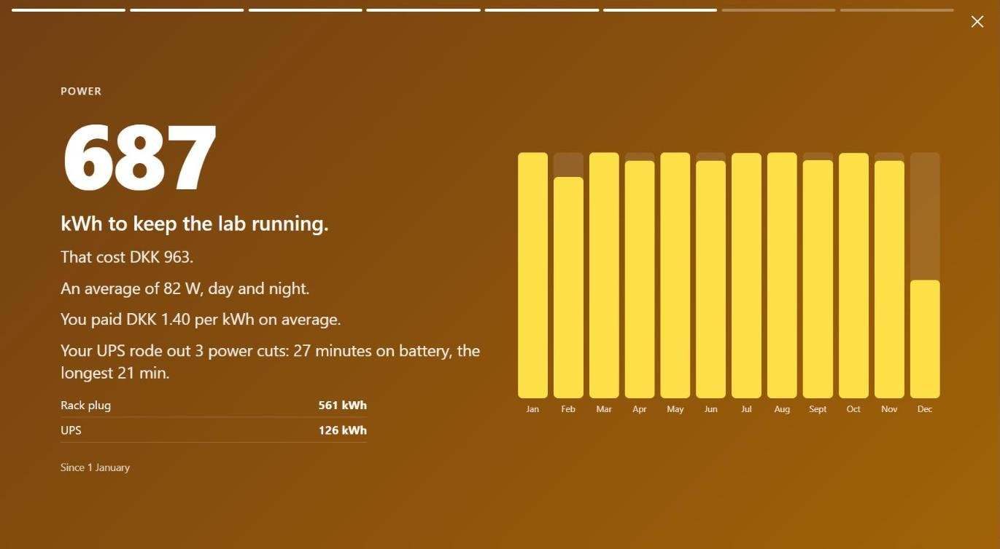
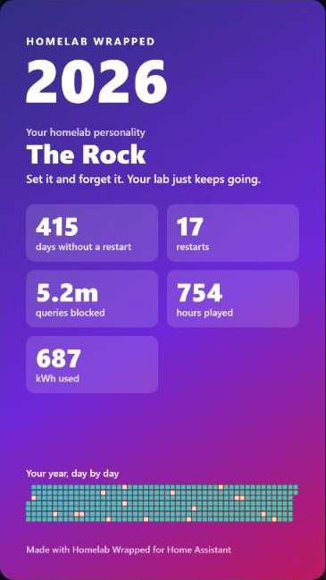

# Homelab Wrapped

[](https://github.com/emilhumm/HomelabWrapped/actions/workflows/tests.yml)
[](https://github.com/emilhumm/HomelabWrapped/actions/workflows/validate.yml)
[](https://www.home-assistant.io/)
[](LICENSE)

Spotify-Wrapped-style story cards for your whole homelab: your longest uptime streak, what
restarted most, how many DNS queries you blocked, hours of media, what the lab cost in power,
and your homelab personality, ending in one image to share.

> **Status: early development.** The coverage check shows which cards your lab can make today and
> what would unlock the rest; **Play your Wrapped** runs the story with the Intro, Uptime,
> Restarts, Blocked, Media, Power and Personality cards, a closing summary and a share image.
> Not yet tried on many real labs: expect rough edges, and please send diagnostics.

## What it looks like

Shown with a made-up lab.



| | |
|---|---|
|  |  |
|  |  |



## The cards

| # | Card | Built from |
|---|------|------------|
| 01 | Your lab | Hosts, guests and containers (Proxmox VE, Glances, System Monitor, Portainer) |
| 02 | Uptime | Longest streak without a restart and a year grid of your servers (Proxmox VE, Glances, System Monitor, Synology DSM, QNAP), and how much of the past 365 days your services were up (Uptime Kuma) |
| 03 | Restarts | What restarted most: servers, with Docker containers (Portainer) and network gear (routers, access points, switches, the firewall) ranked apart |
| 04 | Blocked | DNS queries blocked (AdGuard Home, Pi-hole) |
| 05 | Media | Hours streamed and what you played most (Jellyfin, Plex) |
| 06 | Power | kWh your lab's meters used, priced hour by hour with the Energy dashboard's price, and the power cuts your UPS rode out (NUT, APC UPS Daemon) |
| 07 | Personality | The Rock, the Night Owl, the Gatekeeper …, picked from the cards above |
| 08 | Summary | The year's numbers, and one 9:16 image to share |

A card only appears when its data exists, and says how far back that data goes. A card that
can't be made yet says why: **counting** (the source is connected, but there isn't enough
history yet) or **locked** (connect one of the listed integrations).

## How it finds your data

By what things are, never by what they are called: the integration that made an entity, its
`device_class`, unit and the integration's own `translation_key`, plus the meters and prices in
your Energy dashboard. Renaming entities never breaks anything.

Your lab is the gear that serves the house: servers, VMs, containers and NAS, plus network gear
(ASUS Router, ASUSWRT, OPNsense, UniFi Network, FRITZ!Box, MikroTik, Vodafone Station, devolo,
Huawei LTE, Starlink, QNAP switches, Ubiquiti airOS), which gets a ranking of its own. Lamps,
plugs, printers and other smart-home devices never count, even when they report an uptime.
ASUS Router (`asusrouter`) and OPNsense (`hass-opnsense`) are custom integrations from HACS.

Some of the sensors Wrapped reads are off until you turn them on in their integration: the
*Uptime* sensor of System Monitor, devolo, Synology DSM, QNAP, Ubiquiti airOS and ASUS Router, and
Uptime Kuma's *Uptime (365 days)* (from Home Assistant 2026.11). ASUSWRT only reports a router's
uptime when it connects over HTTP(S), not SSH or Telnet.

Home Assistant only keeps long-term history for sensors with a `state_class`, and a rolling
24-hour count isn't a total. Restarts, DNS blocks and playback disappear after the recorder's
retention period (10 days by default), so
Homelab Wrapped records those itself from the day you install it, as its own sensors that only
count up (HA keeps their long-term history forever):

- **restarts** for every server's, container's and network device's uptime or last-boot sensor,
  including restarts while Home Assistant was down (the machine comes back with a later boot
  time); a Portainer container's from when it last started, so redeploys and updates count too;
  a VM that stops counts once, when it stops, and isn't "up" while it's stopped;
- **blocked DNS queries** for AdGuard Home and Pi-hole, read once a day at 23:55, since both
  report a rolling 24-hour count. For AdGuard Home that's its statistics period, which must stay
  at its default of 24 hours (*Settings → General settings → Statistics*): with 7 days, each
  day's reading would count a week;
- **playback hours** for each media server, over all its players, and the hours per title;
- **power cuts** for each UPS: when it switched to battery, and for how long.

They sit on a *Homelab Wrapped* service device and are hidden from auto-generated dashboards.

When it starts counting something, Wrapped also looks back once over what the recorder still
remembers (the last 10 days by default, more if you keep more), so the cards don't start empty
on the day you install it.

## Privacy

- Read-only: it changes nothing else in Home Assistant; it only adds its own sensors, panel
  and storage.
- Nothing leaves your network.
- The share image is drawn in your browser and leaves machine names out unless you tick
  *Show machine names*. What you watched or listened to is never on it.
- **Copy diagnostics** (in the panel, or the integration's diagnostics download) describes what
  your lab has without a single entity id, name, title, hostname or IP. Paste it into an
  [issue](https://github.com/emilhumm/HomelabWrapped/issues/new/choose) when something isn't found.
- Every Home Assistant user can open the panel: it shows the household's numbers, the most
  played titles included.
- Found a security problem? Please report it privately: see [SECURITY.md](SECURITY.md).

## Which year

The story plays the current year. In January it plays the year that just ended, and once
Wrapped has more than one year of data, the panel lets you pick another.

## Languages

English and Danish, following Home Assistant's language. Translations are welcome: the panel's
texts are in [`frontend/src/text.ts`](frontend/src/text.ts), Home Assistant's in
[`translations/`](custom_components/homelab_wrapped/translations/).

## Power

The Energy dashboard's meters usually measure the whole house, so Wrapped doesn't guess which
ones are the lab's. Pick them under *Settings → Devices & services → Homelab Wrapped →
Configure*: the energy meters (kWh) your servers are on, such as smart plugs, a PDU, or a UPS
that measures energy. A meter that only reports watts can be turned into kWh with an *Integral*
helper. The Power card adds them up and prices every hour with the Energy dashboard's price
sensor (or its fixed price); a price sensor that isn't in the Energy dashboard isn't used.

## Leave out

When two integrations watch the same machine, for example Glances on your Proxmox host, or
System Monitor inside the Home Assistant VM that Proxmox VE already reports, Wrapped counts it
twice: there's no reliable way to tell from the outside. Under *Configure → Leave out*, pick the
devices Wrapped should ignore. Saving reloads Wrapped; a left-out device's history is kept, so
un-ticking it brings it back.

## Install

Homelab Wrapped needs Home Assistant 2026.10 or newer.

**Home Assistant 2026.11 and newer**, where HACS is built in as the Marketplace:

1. *Settings → Marketplace → Add from link*, enter `emilhumm/HomelabWrapped` and select *Add*. The
   first time, the Marketplace asks you to connect GitHub.
2. Open **Homelab Wrapped** in the list and select *Install*. If it isn't under *Add
   integration* afterwards, restart Home Assistant.
3. *Settings → Devices & services → Add integration → Homelab Wrapped.* It appears in the sidebar.

**Home Assistant 2026.10**, with HACS:

1. In HACS, add this repository as a custom repository (category *Integration*).
2. Install **Homelab Wrapped** and restart Home Assistant.
3. *Settings → Devices & services → Add integration → Homelab Wrapped.*

## Troubleshooting

- **A card says *Counting*:** its source is connected, and it needs a week of history; the card
  says on which day it's ready.
- **A card is *Locked*:** connect one of the integrations it lists. Power is locked until you
  pick your lab's meters (see [Power](#power)) or connect a UPS (Network UPS Tools, APC UPS
  Daemon) for its power cuts.
- **No Personality yet:** it appears once two other cards are ready.
- **A machine counted twice:** two integrations watch it; see [Leave out](#leave-out).
- **Something isn't found, or a number looks wrong:** [open an issue](https://github.com/emilhumm/HomelabWrapped/issues/new/choose) with your **Copy
  diagnostics** report.

## Uninstall

Delete Homelab Wrapped under *Settings → Devices & services*, then remove it in the Marketplace
(or HACS) and restart Home Assistant. Its own storage (the counts, what it looked back on, the
titles) goes with it. Home Assistant keeps its sensors' long-term statistics until you remove
them under *Developer tools → Statistics*.

## Add your integration

Support for an integration is one small adapter in
[`core/sources.py`](custom_components/homelab_wrapped/core/sources.py): which integration it is,
and which entities or devices give which kind of data. Start from your lab's **Copy diagnostics**
report, which lists every integration's entities by domain, `device_class`, unit, `state_class`
and `translation_key`. Some integrations only tell their sensors apart by unique id, which the
report leaves out (it can hold a MAC address or a serial number): for those, read the
integration's code. Pull requests are welcome: [CONTRIBUTING.md](CONTRIBUTING.md) says what
one needs.

## Development

Python 3.14, as Home Assistant 2026.10 needs. On Windows, use `.venv\Scripts` instead of
`.venv/bin`; Home Assistant's test plugin also needs two stand-ins there (see `CLAUDE.md`).

```sh
python -m venv .venv
.venv/bin/pip install -r requirements_test.txt
.venv/bin/pytest --cov
.venv/bin/mypy
.venv/bin/ruff check . && .venv/bin/ruff format --check .
```

`custom_components/homelab_wrapped/core/` is plain Python that never imports Home Assistant
(a test checks this), so a standalone version can reuse it.

The panel is TypeScript and Lit in `frontend/`, built to one file:

```sh
cd frontend
npm ci
npm run build   # writes custom_components/homelab_wrapped/frontend/homelab-wrapped-panel.js
```

## License

[MIT](LICENSE)
